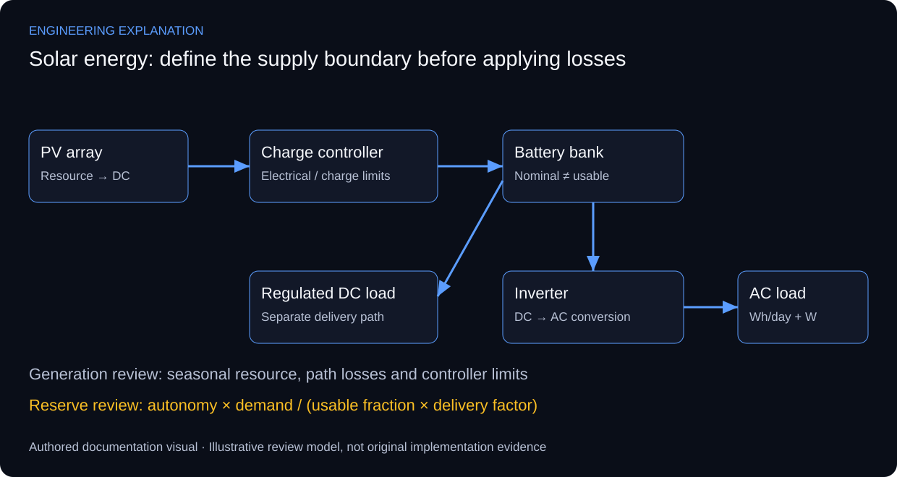

# Solar Energy Systems — Design, Sizing & Deployment

## From daily demand to a reviewable power design

The source photographs show installed photovoltaic and battery/power equipment for telecommunications supply and backup. They support the installation context, but labels in low-resolution images do not reliably establish capacities or battery chemistry. The worked example already on this page uses illustrative inputs and is retained as an explanation rather than an installed equipment schedule.

Start with the load boundary: AC demand measured after an inverter and DC demand on a regulated bus require different loss paths. Compute daily energy from power, quantity and operating time, then review concurrent peak demand and starting loads separately. The load schedule, autonomy requirement and allowed interruptions determine what the system must deliver.

PV sizing compares the required delivered energy with site resource and conversion losses. Annual energy is insufficient to establish continuous service through the least favourable period. PVWatts is a technical reference for photovoltaic production estimates; its grid-connected assumptions do not certify an off-grid battery system. Storage and charging must be assessed separately using the selected equipment data.

Battery reserve is based on delivered energy, usable fraction, temperature and discharge conditions. Controller selection must check array voltage and current across operating extremes, while the inverter must meet the AC load and battery-bus constraints. Protection, isolation and earthing require installation-specific ratings and drawings; the functional visual below does not assign them.

*New explanatory responsibilities and review criteria; not an as-built drawing or new test result.*

## Review scenarios and expected evidence

These are review criteria, not additional completed tests.

| Review area | Method | Evidence to inspect |
|---|---|---|
| Load model | Sum quantity × power × hours | Daily energy with an explicit supply boundary |
| Array/controller | Compare operating voltage/current to device limits | Data sheets and array configuration |
| Battery reserve | Apply usable fraction and delivery losses once | Nominal versus delivered energy |
| Commissioning | Compare measured conditions with design assumptions | Equipment schedule and dated readings |

## Primary technical references

- [PVWatts technical reference manual](https://docs.nrel.gov/docs/fy14osti/62641.pdf)

References support the explanation, not undocumented implementation claims.

The existing numerical sizing example is educational. No installed capacity, measured yield or achieved autonomy is inferred from the photographs.

[Published case study](https://mahyoub88.github.io/projects/proj-solar-study/).
